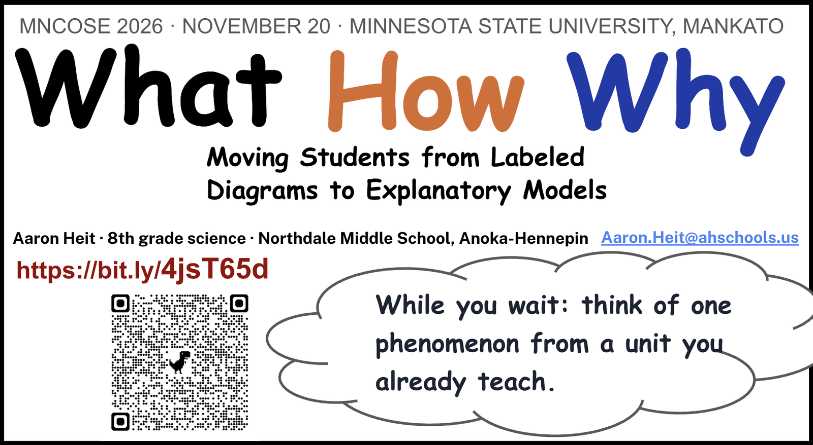

A session for middle and high school science teachers on moving students past labeled drawings toward models that explain.

{.slide-hero fig-alt="Title slide reading What How Why: Moving Students from Labeled Diagrams to Explanatory Models, MnCOSE 2026, November 20, Minnesota State University, Mankato"}

::: {.detail}
Event
: Minnesota Conference on Science Education (MnCOSE) 2026

Date
: Friday, November 20, 2026, 1:40 to 2:30 PM

Location
: Ostrander Hall, Minnesota State University, Mankato

Format
: 50 minutes. Presentation, student work analysis, and participant work time.

Audience
: Middle and high school science teachers and district science leaders

Strands
: Assessment and Grading. Three-Dimensional Instruction.
:::

## The session

On November 20, 2026, I presented "What, How, Why: Moving Students from Labeled Diagrams to Explanatory Models" at the Minnesota Conference on Science Education at Minnesota State University, Mankato.

The session shared a modeling routine I built in my 8th grade classroom at Northdale Middle School in Anoka-Hennepin to move students past labeled drawings toward models that explain. Students ask three questions of every phenomenon. They revise one model of an anchor phenomenon three times across a unit, and every unit test asks them to model a phenomenon they have never seen.

I drew student work from four units: energy, forces and motion, thermal energy and phase change, and magnetic fields. Using that work, I showed how the same three words become assessment look-fors that stack, and I connected the routine to research on scientific modeling and to the modeling verbs in MDE's MCA-IV performance level descriptors.

Participants then drafted their own prompts for a phenomenon from a unit they teach.

The audience was highly receptive. The strongest question came from a 9th grade teacher, who asked whether students could arrive in high school already carrying the routine.

## The routine at a glance

::: {.routine}
::: {.routine-step .step-what}
[What]{.routine-word}

The observable. What can you see happening?
:::

::: {.routine-step .step-how}
[How]{.routine-word}

The mechanism. What is happening that you cannot see?
:::

::: {.routine-step .step-why}
[Why]{.routine-word}

The principle. What rule explains it, and where else does it apply?
:::
:::

## Where this is going

That question changed the project. What, How, Why is a routine for one science and engineering practice: developing and using models. The bigger idea is a routine for every practice, so students meet each one with a short, consistent set of moves they learned once and reach for every time.

When a task says build a model, students know to work through What, How, Why. When it says explain using reasoning, they know to use claim, evidence, and reasoning. Each routine has to be easy for students to start and easy for teachers to teach, and it has to work the same way from one grade to the next, so a student can carry it from elementary school into high school.

That is what I am building now.

## Resources

Everything I handed participants lives in one session document.

::: {.resource}
[Open the session hyperdoc](https://docs.google.com/document/d/1amJPlW6E8cZsTxp0qRbKolnGXp3_b89E11FjnZojG6c/edit?tab=t.0){.resource-link}

Slides, phenomena lists, the student modeling template, and the full works cited.
:::

What's inside:

- Google Slides for the presentation
- Phenomena brainstorm lists for grade 5, grades 6 through 8, and high school
- The student modeling template I print for every unit
- Works cited, with links to every study
- Contact information

<!-- WRITING SECTION. When the Science Scope manuscript is submitted, delete
     this comment line and the closing line below, then fill in the status.

## Writing

A manuscript developing this routine is under review at Science Scope.

-->
